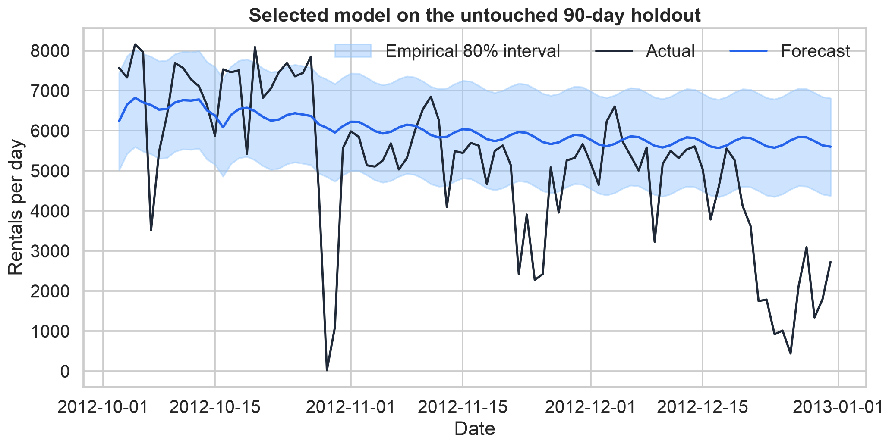
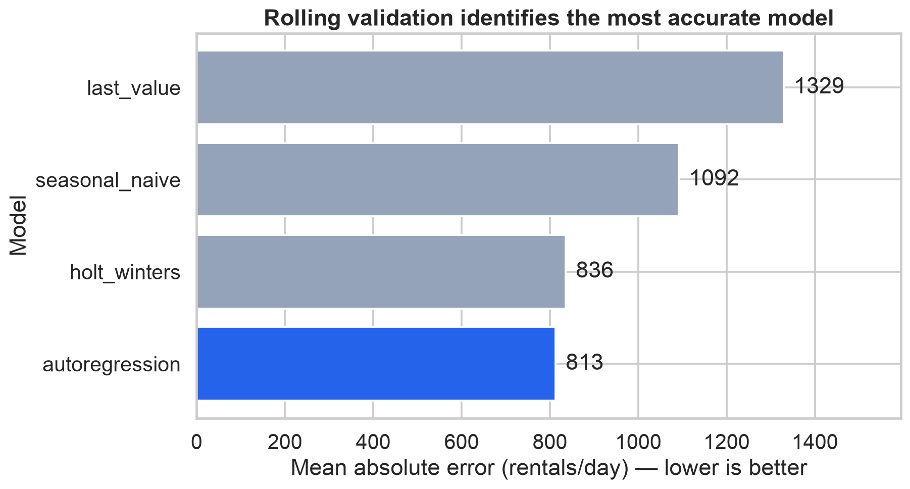

# Demand Forecasting: From Time Series to Decisions

[](https://github.com/sagarmandavkar-UX/demand-forecasting-time-series/actions/workflows/ci.yml)

An end-to-end portfolio project that forecasts daily bike-rental demand, compares multiple forecasting approaches with leakage-safe validation, and converts prediction uncertainty into capacity and staffing guidance.



## Why this matters

Forecasts are only useful when they change a decision. This project addresses four questions:

1. What trend and recurring patterns exist in demand?
2. Which forecasting approach is most reliable on unseen time periods?
3. How uncertain are the predictions?
4. How would the forecast change staffing and capacity plans under an explicit cost scenario?

## Headline results

- **Selected model:** autoregression with lag, rolling, calendar, and trend features
- **90-day holdout MAE:** 1,384 rentals/day
- **Holdout WAPE:** 26.8%
- **Improvement over seasonal naive:** 38.7% lower MAE
- **Empirical 80% interval coverage:** 65.6%
- **Hypothetical capacity-cost change:** 23.9% lower than seasonal naive

These results are predictive comparisons, not causal claims. Business costs are transparent planning assumptions, not observed company financials. The interval's undercoverage is reported plainly: late-2012 demand shifted beyond what earlier validation residuals captured, so production use would require monitoring and recalibration.

## Approaches compared

| Model | Role |
|---|---|
| Last value | Simple no-change baseline |
| Seasonal naive | Repeats the prior week's pattern |
| Holt-Winters | Trend plus weekly seasonality |
| Autoregression | Ridge model with lag, rolling, calendar, and trend features |

Models are selected with expanding-window rolling validation. The final 90 days remain untouched until model selection is complete.



## Decision layer

The project translates the final 30-day point forecast and empirical 80% interval into:

- base operations shifts using the point forecast;
- risk-protected shifts using the interval's upper bound;
- an explicit capacity buffer for high-demand uncertainty;
- a scenario cost that penalizes underforecasting 3.5 times more than overforecasting.

The assumptions are editable in `src/demand_forecasting/business.py`; they are illustrative and should be replaced with real unit economics before deployment.

## Repository structure

```text
├── data/                  # UCI source data and attribution
├── notebooks/             # Executed, presentation-ready analysis
├── reports/               # Reproducible tables, forecast outputs, and figures
├── scripts/               # Download and run entry points
├── src/demand_forecasting # Data, models, evaluation, decisions, visuals
├── tests/                 # Unit and leakage-safety checks
└── .github/workflows/     # Automated test and analysis workflow
```

## Run locally

```bash
python -m venv .venv
source .venv/bin/activate
pip install -e ".[dev]"
python scripts/download_data.py
python scripts/run_analysis.py
pytest
```

Open `notebooks/demand_forecasting.ipynb` for the complete narrative analysis.

## Dataset

This project uses the daily Capital Bikeshare counts from the [UCI Bike Sharing dataset](https://archive.ics.uci.edu/dataset/275/bike+sharing+dataset), donated by Hadi Fanaee-T. The dataset covers 2011–2012, is licensed under [CC BY 4.0](https://creativecommons.org/licenses/by/4.0/), and has DOI [10.24432/C5W894](https://doi.org/10.24432/C5W894).

## Limitations

- The source data spans two years and one metropolitan bike-sharing system.
- Future weather is excluded to avoid using information that would not be known with certainty at planning time.
- The empirical interval is calibrated from historical out-of-sample errors and is not a guarantee.
- Aggregate daily demand cannot guide station-level bike rebalancing.
- The cost and staffing conversion is a scenario for decision analysis, not a claim about Capital Bikeshare's operations.

## License

Project code is released under the MIT License. The source dataset remains under CC BY 4.0 and is attributed above.
